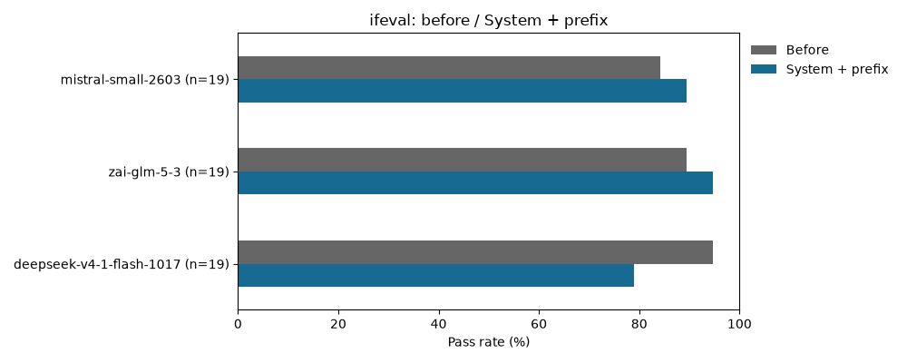
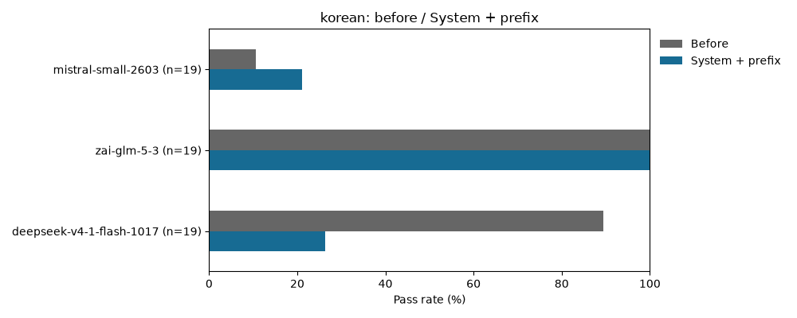
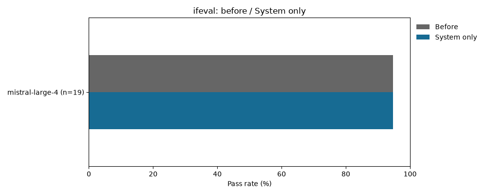
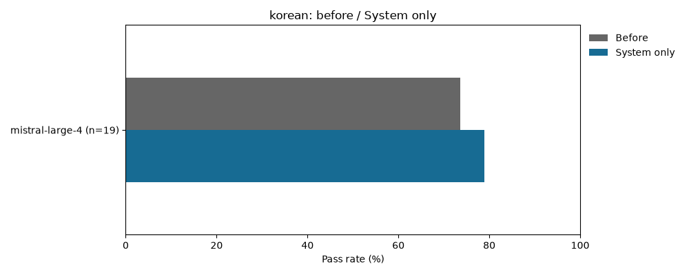

# 모델 응답 평가

Mistral API에서 제공하는 모델의 응답을 평가 항목별로 비교한다. 현재는 지시 준수(instruction following)와 출력 언어 준수(language compliance)를 측정한다. 한국어 언어 혼용은 출력 언어 준수 평가에서 다룬다.

[generate.ipynb](generate.ipynb)에서 같은 모델·질문의 응답과 평가 결과를 저장하고, system 지시·assistant prefix 적용 전후의 통과율과 응답 내용을 비교한다.

## 평가 범위

| 평가 항목 | 데이터와 채점 방식 | 확인하는 내용 |
| --- | --- | --- |
| 지시 준수 | DeepEval의 IFEval 원본 541문항과 채점기 | 문항에 제시된 형식·길이·내용 등의 지시를 따르는지 검사하고, 문항 및 지시별 통과 여부를 기록 |
| 출력 언어 준수 | `data/prompts.json`의 한국어 질문 20개와 문자 검사 | 한국어만 사용하라는 지시에 따라 한글 문자를 포함하고 다른 언어의 문자를 사용하지 않는지 검사 |

두 평가는 응답 품질의 서로 다른 항목을 측정하며 각각의 통과율로 비교한다. 하나의 종합 점수로 합산하지 않는다. 사실 정확성, 질문과의 관련성, 답변의 완전성·자연스러움은 현재 자동 평가에 포함하지 않는다.

## 폴더 구조

```text
response-evaluation/
├── README.md
├── requirements.txt
├── generate.ipynb
├── data/
│   └── prompts.json
└── results/
```

노트북에서 응답 생성·평가·시각화를 실행한다. `data/`에는 직접 작성한 평가 문항을, `results/`에는 응답·평가 결과와 그래프를 저장한다. IFEval 데이터는 DeepEval에서 불러온다.

## 설치와 실행

가상환경을 활성화한 뒤 저장소 루트에서 실행한다.

```shell
cd evaluation/response-evaluation
python -m pip install -r requirements.txt
python -m jupyterlab generate.ipynb
```

이 폴더의 `.env`에 `MISTRAL_API_STUDIO`를 설정한다. 노트북은 `load_dotenv()`로 읽는다. 해당 가상환경의 Python 커널을 선택한다. VS Code의 Jupyter 확장에서도 실행할 수 있다. 작업 디렉터리는 이 실험 폴더를 사용한다.

## 실행 순서

| 코드 셀 | 내용 | 모델 호출 |
| --- | --- | --- |
| 1–2 | 설정, 모델 호출 방식, 저장 함수 | 없음 |
| 3–4 | IFEval·한국어 데이터와 평가 함수 | 없음 |
| 5–6 | 수정 전 응답 생성·채점·저장 | 있음 |
| 7 | 저장된 수정 전 결과 표와 그래프 | 없음 |
| 8–9 | 지원 모델의 system 지시·prefix 조건 생성·저장 | 있음 |
| 10–11 | Mistral Large의 system 지시만 적용한 조건 생성·저장 | 있음 |
| 12–13 | 조건별 전후 비교와 판정이 바뀐 응답 확인 | 없음 |

이미 저장한 결과를 다시 볼 때는 생성 셀을 실행하지 않는다. 설정 셀과 필요한 시각화 셀만 실행하면 된다. 시각화에는 API 호출이 없다.

한국어만 평가하려면 IFEval 데이터·함수 및 생성 셀을 건너뛴다. 시각화·비교 셀에서도 `korean`에 해당하는 호출과 표만 실행한다.

## 평가 설정

첫 코드 셀에서 값을 수정한다.

| 변수 | 용도 |
| --- | --- |
| `MODELS` | 수정 전 평가할 모델 ID 목록 |
| `PREFIX_MODELS` | system 지시·prefix를 함께 적용할 모델 목록 |
| `SYSTEM_MODELS` | prefix 없이 system 지시만 적용할 모델 목록 |
| `N_PROBLEMS` | 각 평가에서 사용할 앞쪽 문항 수. 기본값은 `5`, 전체 문항은 `None` |
| `KOREAN_INSTRUCTION` | 두 조건에서 한국어 질문 뒤에 붙이는 같은 언어 지시 |
| `IFEVAL_SYSTEM`, `IFEVAL_PREFIX` | 수정 후 IFEval의 system 지시와 assistant prefix |
| `KOREAN_SYSTEM`, `KOREAN_PREFIX` | 수정 후 한국어 평가의 system 지시와 assistant prefix |
| `RESULTS` | 결과 폴더. 기본값은 `results` |

기본 모델은 `mistral-small-2603`, `mistral-large-4`, `zai-glm-5-3`, `deepseek-v4-1-flash-1017`이다.

기본 설정은 수정 전 4개 모델 40회, system 지시·prefix 조건 3개 모델 30회, system 지시만 적용하는 Mistral Large 조건 10회로 총 80회 생성 요청이다. 한국어만 전후 평가하면 40회다. 생성 셀을 다시 실행하면 새 API 요청이 발생하고 해당 결과 파일을 덮어쓴다. 전후 비교 중에는 모델 목록과 문항을 바꾸지 않는다.

생성 옵션은 SDK와 모델의 기본값을 사용한다. SDK에서 추론 블록으로 구분한 부분은 제외하고 텍스트 블록을 평가한다. 일반 텍스트에 포함된 태그나 다른 언어의 문장은 그대로 검사한다.

## 저장 파일

```text
results/
├── ifeval_before.json
├── ifeval_after.json
├── korean_before.json
├── korean_after.json
├── ifeval_system_only.json
├── korean_system_only.json
├── ifeval_before.png
├── korean_before.png
├── ifeval_comparison.png
├── korean_comparison.png
├── ifeval_system_comparison.png
└── korean_system_comparison.png
```

각 JSON 파일은 문항별 결과의 배열이다. 한 문항을 완료할 때마다 저장하므로 실행 도중 오류가 나도 그전에 완료한 결과는 남는다. 다시 실행하면 처음 문항부터 평가하며 자동으로 이어서 실행하지 않는다.

| 항목 | 내용 |
| --- | --- |
| `model` | 호출한 모델 ID |
| `prompt` | IFEval 원문 또는 한국어 질문 |
| `response` | 채점한 응답 본문. 수정 후에는 맨 앞의 고정 prefix를 제거한 텍스트 |
| `passed` | 문항 통과 여부 |
| `instruction_scores` | IFEval의 지시별 통과 여부. 한국어 결과에는 없음 |

한국어 요청에는 저장된 질문 뒤에 `KOREAN_INSTRUCTION`을 붙인다. 수정 후의 추가 system 지시와 prefix는 노트북의 상수로 확인한다.

## Prefix 적용 방식

Mistral 공식 예제처럼 마지막 assistant 메시지에 `prefix=True`를 지정한다.

| 조건 | 요청 구성 |
| --- | --- |
| 수정 전 | 기존 user 질문 |
| Prefix 지원 모델의 수정 후 | system 지시 + 같은 user 질문 + assistant prefix |
| Mistral Large의 수정 후 | system 지시 + 같은 user 질문 |

IFEval에는 지시된 언어·형식·길이를 준수하도록 system 지시를 넣고, `Here is the requested answer:\n`을 prefix로 제공한다. 한국어 평가에는 한국어 전용 출력과 원문 병기 금지 지시를 넣고, `한국어 답변:\n`을 prefix로 제공한다.

공식 예제의 prefix 제거 방식에 따라, 응답 맨 앞에 고정 prefix가 있을 때만 제거하고 본문을 저장·채점한다. IFEval의 JSON·첫 문장 제약과 안내 문구가 충돌하는 것을 피하고, 미리 넣은 한글만으로 한국어 검사를 통과하는 것을 방지하기 위한 처리다. 모델이 생성한 외국어, 공백, 문장부호는 별도로 제거하지 않는다.

Mistral Small·GLM·DeepSeek는 system 지시, prefix, prefix 제거를 합친 방식의 효과를 비교한다. prefix만의 효과를 분리한 실험은 아니다. 수정 후 점수가 낮아지는 경우도 그대로 표시한다.

Mistral Large 4는 현재 API에서 `Assistant message prefix is not enabled for this model` 오류를 반환한다. 이 모델에는 같은 system 지시만 추가하고, 응답을 `ifeval_system_only.json`과 `korean_system_only.json`에 저장한다. Prefix 비교와 구분된 그래프로 보여 주며, system 지시만 적용한 결과를 prefix 효과로 해석하지 않는다.

## 표와 그래프 해석

수정 전 표는 모델별 평가 문항 수, 통과 수와 통과율을 보여 준다. 전후 표와 그래프는 같은 모델·질문이 두 결과 파일에 모두 있는 문항만 비교한다. 실행이 중단됐다면 표의 `questions`를 확인한다. 한쪽에만 결과가 있는 문항은 전후 비교에서 제외된다.

`change_pp`는 수정 후 통과율에서 수정 전 통과율을 뺀 퍼센트포인트 차이다. 예를 들어 40%에서 60%로 변하면 +20퍼센트포인트다. 마지막 셀에서는 판정이 바뀐 문항의 전후 응답을 나란히 확인한다.

IFEval 점수는 설치된 DeepEval의 채점 구현을 따른다. 일부 원본 지시를 충분히 검사하지 않는 한계가 있으므로, 점수를 Google 원본 채점기의 결과와 동일하게 해석하지 않는다.

한국어 검사는 영문 약어 하나가 남아도 실패한다. 숫자·공백·문장부호·기호는 언어 문자로 세지 않으며, 빈 응답이나 숫자만 있는 응답은 실패한다. 한글만 사용한 오답도 통과할 수 있으므로 답변의 정확성과 자연스러움은 별도로 확인한다.

기본 한국어 5문항 중 4문항에는 외국어가 포함되어 있다. 적은 문항을 한 번씩 실행한 결과를 일반적인 한국어 대화 전체의 혼용률이나 통계적으로 확정된 개선으로 해석하지 않는다.

## 저장된 비교 그래프

System 지시와 prefix를 함께 적용한 비교:





Mistral Large에 system 지시만 적용한 비교:





## 참고

- [Mistral prefix 예제](https://docs.mistral.ai/resources/cookbooks/mistral-prompting-prefix_use_cases)
- [DeepEval IFEval 문서](https://deepeval.com/docs/benchmarks-ifeval)
